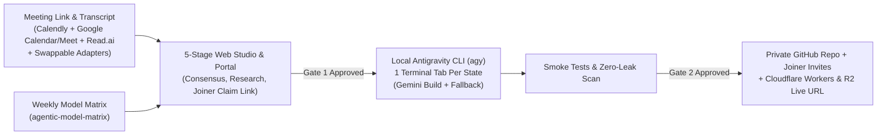

# Conversation-to-Ship

[](https://github.com/maximusmaximus/conversation-to-ship/actions/workflows/ci.yml)
[](https://github.com/maximusmaximus/conversation-to-ship/actions/workflows/pages.yml)
[](https://maximusmaximus.github.io/conversation-to-ship/)
[](https://maximusmaximus.github.io/agentic-model-matrix/)

End-to-end **Idea-to-Production Web Platform** that turns a human meeting into a deployed, working Cloudflare web application—featuring a **GitHub Pages Sign-Up & Public Showcase Portal**, Google Account login, per-user **Integrations Dashboard**, **`Public / Private / Hidden`** project visibility (`Current` & `Past` public feeds across all users), multi-tab **Antigravity CLI (`agy`)** execution, and a **Cloudflare Workers + D1 + R2** API backend.

## Live Surfaces & Specifications

- **[GitHub Pages Portal (`docs/`)](https://maximusmaximus.github.io/conversation-to-ship/)** — Intro landing page with `"Connect Account to Start Integrations"`, Google Sign-In, user profile & integrations dashboard, project visibility controls (`Public` / `Private` / `Hide`, `Current` / `Past`), and live public showcase across all users.
- **[Cloudflare Worker Backend (`worker/`)](worker/src/index.ts)** — D1 schema ([`worker/migrations/0001_init.sql`](worker/migrations/0001_init.sql)), Google ID token verification, R2 webhook storage, user integrations API, and public showcase feed (`GET /api/public/projects`).
- **[Complete Build Specification (`docs/BUILD_SPEC.md`)](docs/BUILD_SPEC.md)** — Authoritative end-to-end architecture, Gate 1 & Gate 2 HITL workflows, local `agy` multi-tab bridge, golden app stacks, and Cloudflare deployment pipeline.
- **[Swappable Provider Contracts (`docs/PROVIDER_CONTRACTS.md`)](docs/PROVIDER_CONTRACTS.md)** — Canonical domain events and typed interfaces making Calendly, Google Calendar, Google Meet, Read.ai, Google Meet Drive transcripts, `.vtt/.ics` uploads, GitHub, and Cloudflare interchangeable.
- **[Database Schema & API Contract (`docs/DATABASE_AND_API.md`)](docs/DATABASE_AND_API.md)** — Relational tables (D1/Postgres compatible), Google Auth & Integration routes, webhook endpoints, 1-click Claim Link OAuth flow, Bridge Worker lease endpoints, and WebSocket streams.
- **[Weekly Best-Practices & Model Matrix (`modules/model-matrix`)](https://github.com/maximusmaximus/agentic-model-matrix)** — Separate public repository mounted as a submodule and published via CORS-enabled GitHub Pages API ([Live Dashboard](https://maximusmaximus.github.io/agentic-model-matrix/) · [`llms.txt`](https://maximusmaximus.github.io/agentic-model-matrix/llms.txt) · [`routing.json`](https://maximusmaximus.github.io/agentic-model-matrix/routing.json)), mapping coding best practices across 6 SDLC stages while pinning **Stage 5 (`app_build`) to Gemini models on Antigravity**.



## Key Capabilities Specified

1. **Swappable Toolchain:** Webhook-first support for Calendly, Google Calendar, Google Meet, and Read.ai, paired with Day-1 secondary adapters (`google_meet_drive`, `.vtt/.srt/.txt` uploads, `.ics` feeds, and an Outlook/Graph contract stub) plus deterministic cascade session correlation.
2. **Meeting-Link Joiners → GitHub Access:** Merges Calendar invitees, Google Meet Participants API, Read.ai rosters, and a 1-click `"Claim Repo Access"` GitHub OAuth link so anyone joining via the meeting link can be onboarded into the product repository after Gate 2 approval.
3. **Transcript Semantics & Deep Research:** Separates verbatim-quote-backed **Consensus Requirements**, **Open for Research**, **Contested**, and **Out-of-Scope** items; executes bounded web/docs research for open items and feeds cited Decision Briefs into Gate 1.
4. **Multi-Tab Antigravity CLI (`agy`) Execution:** Uses an outbound-only Local Bridge Worker (no inbound network exposure) to spawn one visible Windows Terminal (`wt.exe`) tab per project state (`1-Requirements`, `2-Research`, `3-Specs`, `4-Gemini-Build`, `5-QA-Deploy`) and stream logs back to the Web UI.
5. **Cloudflare Runtime & R2 Storage:** Stores transcripts, research briefs, logs, and build bundles in Cloudflare R2; deploys preview and production applications on Cloudflare Workers / Pages; and handles follow-up meetings via `delta/*` PR branches.
6. **Zero-Leak Public Hygiene:** Pre-commit and CI scanners ([`scripts/security_scan.py`](scripts/security_scan.py)) block secrets, PII, local paths, hostnames, and private IP addresses. Live runtime state never enters git.

## Local Validation

```bash
git clone --recurse-submodules https://github.com/maximusmaximus/conversation-to-ship.git
cd conversation-to-ship
pip install -r requirements.txt
python scripts/security_scan.py --root .
python scripts/validate_spec.py --root .
pytest -v
```

## Continuous Integration

[`.github/workflows/ci.yml`](.github/workflows/ci.yml) runs on every push and pull request with recursive submodules to verify zero-leak scanning (`scripts/security_scan.py`), specification & `agentic-model-matrix` v1.1.0 alignment (`scripts/validate_spec.py`), JSON Schema checks, and `pytest`.
