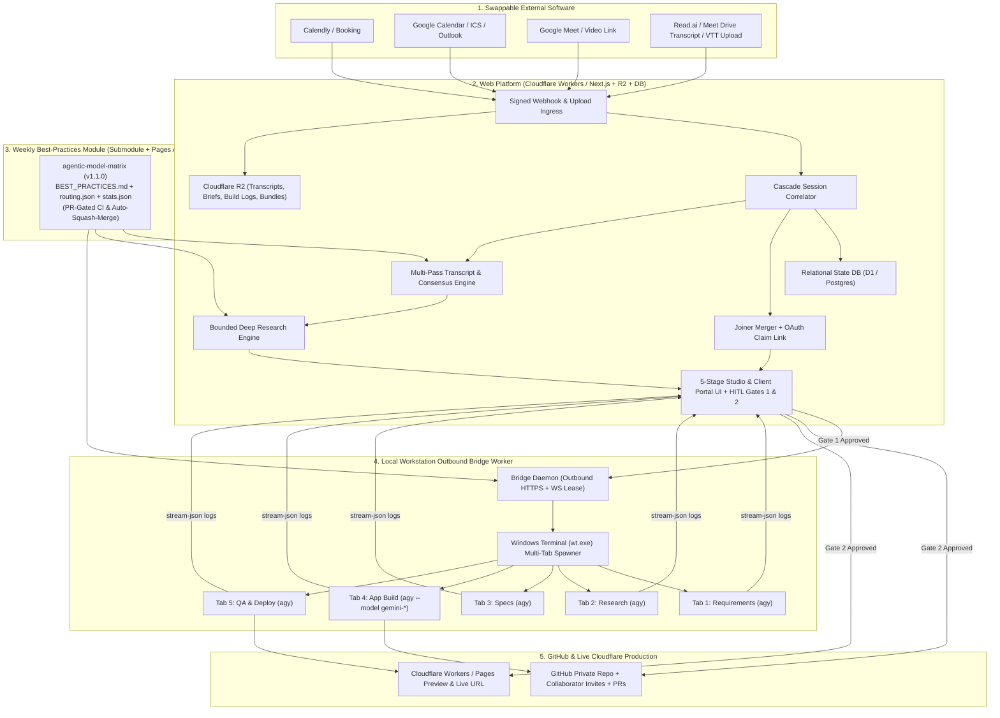

# Conversation-to-Ship: Complete Idea-to-Production Web Application Build Specification

> **Status:** Authoritative Architecture & Implementation Blueprint  
> **Public Repository Policy:** Zero secrets, zero private network identifiers, zero device names, zero personal runtime artifacts.  
> **Companion Module:** [`agentic-model-matrix`](https://github.com/maximusmaximus/agentic-model-matrix) (mounted at [`modules/model-matrix`](../modules/model-matrix))

---

## 1. Purpose & Architectural Decisions Ledger

This document specifies how to build a complete **Studio + Client Portal web application** that turns a human conversation into a deployed, working web application—automatically capturing meeting-link participants into the resulting product repository, separating transcript consensus from open research items, driving multi-tab **Antigravity CLI (`agy`)** workflows using a weekly-updated coding best-practices and model-routing matrix, and deploying live previews and production builds on **Cloudflare (Workers, Pages, and R2)**.

### Locked Architectural Decisions (Q1–Q20)

| # | Area | Decision |
| --- | --- | --- |
| **1** | **Main Repo Topology** | Clean, standalone public repository absorbing sanitized vertical-slice, quote-provenance, and PR-safety patterns. |
| **2** | **Weekly Best-Practices Module** | Separate public repo ([`agentic-model-matrix`](https://github.com/maximusmaximus/agentic-model-matrix)) referenced as a Git submodule (`modules/model-matrix`) plus CORS-enabled GitHub Pages JSON/Markdown/llms API (`https://maximusmaximus.github.io/agentic-model-matrix/`). |
| **3** | **Zero-Leak Guardrails** | Pre-commit + CI scanner (`scripts/security_scan.py`) blocking secrets, PII, local paths, hostnames, and private IP ranges; runtime state kept out of git. |
| **4** | **Weekly Matrix Generator** | Automated GitHub Actions workflow (`06:00 UTC` schedule + Monday rollover + dispatch) probing public benchmarks/docs, regenerating `routing.json` (`v1.1.0`) + `stats.json` + `BEST_PRACTICES.md`, opening a PR, verifying CI, and auto-squash-merging on green. |
| **5** | **Model-to-Stage Mapping** | 6 SDLC stages (`triage`, `research`, `consensus_specs`, `architecture`, `app_build`, `qa_deploy`) in `BEST_PRACTICES.md` + `routing.json`; **`app_build` strictly pinned to Gemini models on Antigravity**. |
| **6** | **Update & Quota Fallback** | PR merge required to activate weekly matrix updates; ordered Gemini-on-Antigravity fallback chain on quota/capacity exhaustion. |
| **7** | **Web App Tenancy** | **Studio + Client Portal**: operators manage builds and local CLI tabs; meeting invitees/joiners view progress and claim repo/app access. |
| **8** | **Web Workspace UX** | 5-stage live workspace: `1. Intake/Links`, `2. Transcript Signals`, `3. Research & Specs`, `4. Antigravity Tab Stream`, `5. Live App Preview`. |
| **9** | **HITL Approval Gates** | Two mandatory Web UI approval gates: **Gate 1** (Consensus & Specs Lock) and **Gate 2** (Pre-Deploy & Repo-Invite Release). |
| **10** | **Swappable Tooling Core** | Normalized internal domain events + typed Provider Adapters selected via config or Web UI. |
| **11** | **Default Stack Ingestion** | Webhook-first endpoints for paid Calendly, Read.ai, and Google Calendar push notifications (plus manual/API helpers). |
| **12** | **Session Correlation** | Deterministic cascade join: `Meet URL/code -> Calendar iCalUID/eventId -> Calendly URI -> ±15 min + email overlap`. |
| **13** | **Day-1 Secondary Adapters** | Built Day 1 alongside defaults: Google Meet native Docs/Drive transcripts + `.vtt/.srt/.txt` upload; Generic `.ics` feed + Outlook/Graph stub. |
| **14** | **Meeting-Link Joiners** | Merge Google Calendar invitees + Google Meet Participants API + Read.ai roster **plus** 1-click "Claim Repo Access" GitHub OAuth check-in link shared in meeting chat and portal. |
| **15** | **Repo & Collaborator Policy** | Private repo by default under configurable owner/org; verified joiners receive `Write` (`push`, configurable `pull`/`triage`) after Gate 2 approval. |
| **16** | **Transcript Classification** | Multi-pass LLM extraction anchored to verbatim speaker quotes into `Consensus Requirements`, `Open for Research`, `Contested`, and `Out-of-Scope`. |
| **17** | **Research Loop Closure** | Bounded web/docs research emits cited Decision Briefs; low-risk picks pre-fill specs for Gate 1 confirmation, high-impact choices require human selection. |
| **18** | **Antigravity CLI Multi-Tab** | Outbound Local Bridge Worker spawns visible Windows Terminal (`wt.exe`) tabs per project state via `agy` and streams NDJSON logs back to the Web UI. |
| **19** | **Golden Target Stacks** | Next.js (App Router + TypeScript + Tailwind + SQLite/D1/Postgres) default, or FastAPI + React/Vite when Python is constrained, with mandatory smoke tests. |
| **20** | **Cloudflare Deploy & Delta** | Deploy via **Cloudflare Workers / Pages + Cloudflare R2** (artifacts, transcripts, bundles); live URL sent to attendees; follow-up calls open `delta/*` PR branches. |

---

## 2. End-to-End System Architecture

### Critical Security Boundary for Local Execution
Because the Web Platform runs on the public internet (e.g., Cloudflare Workers / cloud host) while `agy` executes on the operator's local workstation, **the cloud platform NEVER connects inbound to the workstation**. Instead, the Local Bridge Worker opens an **outbound authenticated TLS WebSocket + HTTPS polling lease** to the Web Platform, claims queued stage jobs, runs `wt.exe` + `agy` locally, and streams sanitized progress events back up. Zero private hostnames, LAN IPs, or SSH tunnels are ever exposed in public code or configuration.

---

## 3. Web Application UX: GitHub Pages Portal, Auth & Studio

### 3.1 Public Marketing Portal, Alpha Gate, Google Sign-In & User Validation
The public front door lives on **GitHub Pages** (`docs/` at `https://maximusmaximus.github.io/conversation-to-ship/`) backed by the **Cloudflare Worker API** (`worker/`):
- **Simple Marketing Landing Page (`In Alpha Now`):** Presents what the product does in plain, non-technical terms without exposing internal implementation mechanics on the marketing surface, displays a clear **`Alpha Now`** status notice, includes a **`Connect Account to Start Integrations`** CTA, and provides an inline **Contact Form (`POST /api/contact`)**.
- **Public Showcase Across All Users (Main Home Page):**
  - **`Current Public Projects`:** Lists active/in-progress and live current deployments across all users where `visibility === "public"` and `lifecycle === "current"`.
  - **`Past Public Projects`:** Lists completed/archived public ships across all users where `visibility === "public"` and `lifecycle === "past"`.
- **Three-State Visibility & Lifecycle Controls:**
  - **`Public`:** Published onto the main Home Page showcase under either *Current Public Projects* or *Past Public Projects*.
  - **`Private`:** Visible only to the project owner and verified meeting-link collaborators (never listed publicly).
  - **`Hidden`:** Excluded from the public showcase and hidden from the owner's default active dashboard view unless *"Show Hidden"* is toggled on.
- **Secret-Backed Single Admin & User Validation:**
  - **Sole Admin (`admin`):** Configured strictly via Cloudflare Worker secret `ADMIN_EMAIL` (never committed in source code or public config). When that verified Google account signs in, an additional **`Admin`** navigation menu item unlocks the **Admin Console** (`GET /api/admin/overview`, `/api/admin/users`, `/api/admin/actions`, `/api/admin/projects`, `/api/admin/contacts`) featuring platform stats, account validation, project moderation, and **cleanly formatted inline user actions** underneath each user record.
  - **New Signed-Up User (`user`):** Signs in on GitHub Pages via **Google Identity Services (`POST /api/auth/google`)**. Every new non-admin user starts in `approval_status = "pending"` and remains blocked (`403`) from creating projects or configuring integrations until validated (`"approved"`) in the Admin Console.
  - **Click-Through Integration Onboarding:** Integrations expose 1-click OAuth initiation (`POST /api/oauth/:provider/init` → `/api/oauth/:provider/callback`) when platform OAuth app secrets are configured, or direct pre-scoped authorization links plus one-click built-in adapters so users paste as little as possible.
  - **Meeting Joiner / Collaborator (`participant`):** Authenticates via the **1-Click "Claim Repo Access" GitHub OAuth link** (`GET /claim/:projectSlug?token=...`), views read-only project progress and live preview URLs, and receives their GitHub repo invite on Gate 2 release.

### 3.2 Five-Stage Live Workspace (`/projects/:id`)

1. **Tab 1 — `Intake & Links`:**
   - Displays correlated booking metadata, calendar event details, meeting join link, and active provider health badges (Booking / Calendar / Call / Transcript / Repo / Deploy).
   - Provides a **1-Click Copy "Claim Repo Access" Link** button to paste directly into the Google Meet chat during a live call.
   - Displays the **Merged Participant Roster** showing each attendee's source (`calendar`, `meet_api`, `read_ai`, `oauth_claim`), resolved GitHub username (or pending email invite state), and planned repo permission (`push`, `triage`, `pull`).
   - Supports manual fallback uploads (`.vtt`, `.srt`, `.txt`, `.json` transcripts and `.ics` calendar events) for ad-hoc calls.

2. **Tab 2 — `Transcript Signals`:**
   - Displays speaker-attributed transcript timeline stored in Cloudflare R2 and indexed in DB.
   - Splits extracted items into 4 color-coded columns with verbatim quote cards and timestamps:
     - **Consensus Requirements (`REQ-*`)**
     - **Open for Research (`RES-*`)**
     - **Contested / Unresolved (`OPEN-*`)**
     - **Out of Scope (`OOS-*`)**
   - Highlights hypothesis drift (`confirmed | drifted | unresolved | never_discussed`) comparing pre-meeting booking objective vs. actual call quotes.

3. **Tab 3 — `Research & Specs` (HITL Gate 1):**
   - Renders each `RES-*` Decision Brief generated by the Research Engine (options, tradeoff matrix, cited primary URLs, recommended choice).
   - **Low-risk technical decisions** appear pre-selected with an inline override dropdown; **high-impact decisions** (auth, pricing, scope expansion, third-party spend) show an amber `Action Required` picker.
   - Shows the live diff preview of `slice.md`, `requirements.json`, and `spec.md`, plus the active `agentic-model-matrix` `week_id`, `content_hash`, and assigned stage models.
   - **Gate 1 Button (`Lock Specs & Launch Antigravity Build`):** Disabled until all `Contested` and high-impact `RES-*` items have a human selection. Clicking transitions state to `SPEC_LOCKED` and enqueues local Antigravity tabs.

4. **Tab 4 — `Antigravity Tab Stream`:**
   - Real-time multi-pane viewer mirroring the **5 local Windows Terminal (`wt.exe`) + `agy` tabs** (`1-Requirements`, `2-Research`, `3-Specs`, `4-Gemini-Build`, `5-QA-Deploy`).
   - Displays live `agy` model ID (e.g., `gemini-4-neon-xhigh` for Stage 5 `app_build`), effort level, `--conversation` ID, quota fallback events if a Gemini model steps down, changed file list, and smoke-test output (`typecheck`, `lint`, `build`, `HTTP /health`, `security_scan.py`).
   - Allows the operator to pause, retry a failed tab, or manually step down the Gemini fallback chain.

5. **Tab 5 — `Live App Preview` (HITL Gate 2):**
   - Shows an embedded iframe / external preview link to the **Cloudflare Workers / Pages Preview URL** plus R2 build bundle checksum and automated verification report.
   - Shows the exact GitHub PR / new private repo creation preview and pending collaborator invite list.
   - **Gate 2 Button (`Approve Deploy & Send Repo Invites`):** Atomically creates/updates the GitHub repo or PR, invites all verified meeting-link joiners with their configured role, promotes the preview build to production Cloudflare route, and notifies participants with repo + live app URLs.

---

## 4. Swappable Provider Engine & Cascade Correlation

Detailed interface definitions live in [`docs/PROVIDER_CONTRACTS.md`](PROVIDER_CONTRACTS.md). Every external software integration implements a stateless, testable adapter behind a typed registry loaded from `config/providers.yaml`.

### 4.1 Pluggable Adapter Categories

| Category | Day-1 Primary Adapter | Day-1 Secondary Adapters | Normalized Domain Event(s) |
| --- | --- | --- | --- |
| **Booking** | `calendly` (paid `invitee.created` webhook + PAT API) | `generic_webhook` (built-in portal booking form / Cal.com compatible JSON) | `BookingScheduled` |
| **Calendar** | `google_calendar` (Push Notification `watch` channel + Calendar REST) | `generic_ics` (`.ics` upload/URL poll), `outlook_stub` (Microsoft Graph contract stub) | `CalendarEventSynced` |
| **Meeting** | `google_meet` (Google Meet REST `conferenceRecords` + `participants`) | `generic_link` (URL extraction & manual roster) | `MeetingRosterCaptured` |
| **Transcript** | `read_ai` (`meeting_end` webhook + Read MCP / REST API pull fallback) | `google_meet_drive` (Google Docs/Drive Meet transcript export), `manual_upload` (`.vtt`, `.srt`, `.txt`, `.json`) | `TranscriptReady` |
| **Repo** | `github` (GitHub App / OAuth + `gh` / REST API) | Extensible `RepoProvider` interface | `RepoProvisioned`, `CollaboratorInvited`, `PullRequestOpened` |
| **Deploy** | `cloudflare` (Cloudflare Workers / Pages + Wrangler + R2) | Extensible `DeployProvider` interface | `ArtifactStored`, `PreviewDeployed`, `ProductionDeployed` |

### 4.2 Cascade Correlation Algorithm
Because webhooks from Calendly, Google Calendar, Google Meet, and Read.ai arrive out of order, correlation runs idempotently on every incoming event in strict priority order:

1. **`meet_url_code` (Exact):** Normalize conference link (`https://meet.google.com/abc-defg-hij` → `meet:abc-defg-hij`). Highest confidence.
2. **`calendar_ical_uid` (Exact):** Match Google Calendar `iCalUID` or `eventId` across calendar sync and booking payload.
3. **`calendly_event_uri` (Exact):** Match Calendly scheduled event URI.
4. **`time_window_plus_email` (Fallback):** Match any unlinked session within `±15 minutes` of `start_time` sharing at least one normalized participant email (excluding automated bot addresses).
5. If no match exists, create a new candidate `Session` record and mark `correlation_confidence` so the operator can merge manually in Tab 1 if needed.

---

## 5. Meeting-Link Joiners → Automated GitHub Repo Access

A core requirement is that **anyone who joins a meeting with a link gets added to the product repository** once approved. Relying solely on Calendly's original booker misses forwarded links and ad-hoc teammates.

### 5.1 Four-Source Roster Merger
1. **Calendar Invitees (`google_calendar` / `generic_ics`):** Captures all originally invited emails and organizer role.
2. **Call Participants (`google_meet` Conference Records API):** Polls `conferenceRecords.participants` & `participantSessions` after call end to capture external/forwarded joiners (signed-in Google emails or display names).
3. **Transcript Roster (`read_ai` / `google_meet_drive`):** Extracts attendee emails and speaker labels from transcript metadata.
4. **1-Click "Claim Repo Access" Check-In Link (`GET /claim/:projectSlug?token=...`):**
   - Generated automatically when a meeting session is created.
   - Posted into the Google Meet chat (manually or via meeting helper) and included on the project portal page.
   - Clicking initiates standard GitHub OAuth (`read:user`, `user:email`), binds the attendee's verified GitHub username + primary email directly to the meeting roster, and handles anonymous or personal-email joiners cleanly.

### 5.2 Repository Provisioning & Permission Rules
- **Default Visibility:** `private` under `DEFAULT_GITHUB_OWNER` (org or user account), overridable to `public` in the Studio UI before Gate 2.
- **Default Permission Mapping:**
  - Meeting Organizer / Studio Operator → `admin` / `maintain`
  - Verified Meeting-Link Joiners (OAuth claimed or GitHub email matched) → `push` (**Write**) by default, configurable per attendee in Tab 1 to `triage` or `pull` (**Read**).
  - Unverified Emails (no GitHub match via `/search/users` and no OAuth claim yet) → queued for GitHub email collaboration invite or held in `pending_claim` until they click the Claim Link.
- **Gate 2 Safety:** Invitations are staged in the DB and **dispatched via GitHub Collaborators API only when Gate 2 is approved** (unless the operator enables `invite_immediately_on_claim` per project).
- **Follow-Up Meetings:** New joiners on subsequent meetings for an existing product repo are cleanly appended as collaborators without recreating the repo.

---

## 6. Transcript Parsing, Deep Research & Consensus Engine

Replaces brittle keyword regexes with a deterministic, quote-anchored pipeline:

### 6.1 Multi-Pass Extraction Pipeline
1. **Pass 1 — Utterance Normalization (`triage` model from `routing.json`):**
   - Converts Read.ai JSON, Google Docs transcript, `.vtt`, `.srt`, or plain dialogue into canonical utterances: `{ utterance_id, speaker_name, speaker_email, role, start_ms, end_ms, text }`.
   - Stores immutable raw and normalized JSON in Cloudflare R2 (`projects/{id}/transcripts/...`).
2. **Pass 2 — Structured Semantic Extraction (`consensus_specs` model):**
   - Classifies segments using strict JSON schema output. Every extracted item **must** include `quote_ids[]`, `verbatim_quote`, `speaker`, and `confidence`.
   - **Four Output Buckets:**
     - `consensus_requirements` (`REQ-*`): Explicit multi-speaker agreement or uncontested decision-maker commitment (e.g., *"Let's build X with Y"* followed by confirmation).
     - `open_for_research` (`RES-*`): Explicit uncertainty, feasibility questions, library/API comparisons, or unverified assumptions (*"Need to check if Cloudflare R2 supports X"*, *"Compare auth options"*).
     - `contested` (`OPEN-*`): Disagreements between speakers or ambiguous requirements lacking resolution.
     - `out_of_scope` (`OOS-*`): Explicitly deferred or rejected features, promoted as strict negative constraints during code generation.
3. **Pass 3 — Hypothesis vs. Evidence Drift Check:**
   - Compares pre-meeting booking `objective` against `REQ-*` + `OPEN-*` and labels the meeting `confirmed`, `drifted`, `unresolved`, or `never_discussed`.

### 6.2 Bounded Automated Research Engine (`RES-*` Loop Closure)
For every item in `open_for_research`:
1. Runs under strict per-item budgets (`max_minutes_per_item: 4`, `max_web_queries_per_item: 5`) using the model assigned to Stage 2 (`research`) in `routing.json`.
2. Queries official documentation, package registries, and public web sources to produce a **Decision Brief** (`projects/{id}/research/RES-001.md` in R2) containing:
   - Question & verbatim trigger quote
   - 2–3 concrete technical options with pros/cons and primary source URLs
   - Recommended choice + risk classification (`low_risk_technical` vs. `high_impact_product`)
3. **Gate 1 Resolution Rule:**
   - **`low_risk_technical`** (e.g., library choice, schema layout, Cloudflare binding syntax): pre-filled as the default recommendation in Tab 3 so the human can approve with one click or override.
   - **`high_impact_product`** (pricing, user auth model, external paid APIs, scope trade-offs): intentionally left unselected at Gate 1 until a human chooses an option.
4. Selected answers convert into locked `REQ-*` records with provenance pointing back to both the original meeting quote and the research citation.

---

## 7. Weekly Best-Practices & Model-Routing Module Integration

The platform never hardcodes static model IDs inside application business logic. Instead, it reads [`modules/model-matrix/routing.json`](../modules/model-matrix/routing.json) and [`modules/model-matrix/BEST_PRACTICES.md`](../modules/model-matrix/BEST_PRACTICES.md) from the companion repository [`agentic-model-matrix`](https://github.com/maximusmaximus/agentic-model-matrix) (or fetches the live CORS-enabled GitHub Pages endpoints: `routing.json`, `stats.json`, `history.json`, and `llms.txt` at `https://maximusmaximus.github.io/agentic-model-matrix/`).

### 7.1 PR-Gated Consumption & Content-Hash Pinning
- Automated GitHub Actions in `agentic-model-matrix` run daily (`06:00 UTC`) and on weekly rollovers to probe public benchmarks/docs (`antigravity-docs`, `antigravity-changelog`, `arena-coding`, `swe-bench-verified`, `livebench-coding`, `cloudflare-workers-docs`), regenerate `routing.json` (`v1.1.0`) + `stats.json` + `BEST_PRACTICES.md` + `docs/`, open a Pull Request, run independent CI (zero-leak scan, JSON Schema Draft 2020-12 validation, artifact parity, `pytest`), and squash-merge only when all checks pass.
- **Updates activate only after PR merge.** The main web platform consumes either the pinned Git submodule commit or the merged `pages_api` / `main` feed, recording `week_id`, `schema_version`, and `content_hash` onto `projects` and every `antigravity_runs` row for deterministic reproducibility.

### 7.2 Stage 5 Policy, Orchestrator Pattern & Ordered Gemini Fallback
- `agentic-model-matrix` enforces a hard schema invariant (`stats.stage5_pinned_to_gemini: true`): Stage 5 (`app_build`) must have `primary_provider == "antigravity"`, `model_family == "gemini"`, and every entry in `fallback_chain` must be a Gemini model.
- Current baseline routing (`2026-W47`, `schema_version: 1.1.0`) resolves from `routing.json` as:
  - `triage`: `gemini-4-hydrogen-high` (`medium`, `plan`)
  - `research`: `gemini-4-neon-high` (`high`, `plan`)
  - `consensus_specs`: `gemini-4-neon-high` (`high`, `plan`)
  - `architecture`: `claude-opus-5-5-high` (`high`, `plan`)
  - `app_build` *(Gemini-pinned)*: `gemini-4-neon-xhigh` (`xhigh`, `accept-edits`) with ordered fallback chain `gemini-4-neon-xhigh` → `gemini-4-carbon-high` → `gemini-4-neon-high` → `gemini-4-hydrogen-high` → `gemini-4-argon-high`
  - `qa_deploy`: `gemini-4-neon-high` (`high`, `accept-edits`)
- **Orchestrator & Fallback Execution:** Following `agentic-model-matrix` Stage 5 best practices, multi-file feature slices pair `Gemini 4 Neon` as planner with parallel `Gemini 4 Hydrogen` subagents via Antigravity Orchestrator (`gemini-pro-orchestrator-neon`). If any Gemini tier hits a 5-hour or weekly quota/capacity limit mid-run, the Local Bridge Worker steps down cleanly along `fallback_chain[i + 1]`, passes `--conversation <conversation_id>` so file state and context stay intact, and emits a `model_fallback` event to Tab 4 in the Web UI.

---

## 8. Local Antigravity CLI (`agy`) Multi-Tab Bridge Worker

To run interactive, state-separated Antigravity CLI sessions on the operator's Windows workstation while keeping the Web UI live, the system includes a lightweight **Local Bridge Worker** (`bridge-worker`).

### 8.1 Outbound Lease Protocol
1. Operator starts the bridge locally (`python -m bridge_worker --server https://app.example.com`).
2. Bridge authenticates via `Authorization: Bearer $BRIDGE_WORKER_TOKEN` over HTTPS/WebSocket (strictly outbound; zero open local ports).
3. When Gate 1 (or an upstream intake trigger) queues a stage job, the bridge claims a time-bounded lease (`POST /api/bridge/jobs/claim`) with project workspace details and compiled prompt/artifact URLs downloaded from R2.

### 8.2 One Terminal Tab Per Project State (`wt.exe` + `agy`)
For each project state, the bridge spawns a dedicated, clearly titled **Windows Terminal (`wt.exe`)** tab running `agy` in the project's git worktree/directory, piping output through a local tee-streamer that uploads structured events back to `POST /api/bridge/jobs/:id/events`:

| Tab Title | Project State | `routing.json` Stage | Recommended `agy` Invocation Flags | Output Artifact |
| --- | --- | --- | --- | --- |
| `1-Requirements` | Organize consensus & open items | `consensus_specs` | `agy --mode plan --model <stage3> --effort <effort> --add-dir <workspace>` | `requirements.json`, `slice.md` |
| `2-Research` | Execute bounded research | `research` | `agy --mode plan --model <stage2> --effort <effort> --add-dir <workspace>` | `research/RES-*.md` |
| `3-Specs` | Write architecture & build spec | `architecture` | `agy --mode plan --model <stage4> --effort <effort> --add-dir <workspace>` | `spec.md`, `build_prompt.md` |
| `4-Gemini-Build` | Build full web application | `app_build` (**Gemini pinned**) | `agy --mode accept-edits --model <gemini_stage5> --effort xhigh --project <project>` | Full app source + tests on branch |
| `5-QA-Deploy` | Run verification & Cloudflare deploy | `qa_deploy` | `agy --mode accept-edits --model <stage6> --effort high --add-dir <workspace>` | Test report, security scan, preview URL |

- **Dual Execution Mode Support:** Each tab wraps `agy` with `--output-format stream-json` for machine-parseable progress streaming when headless, or `--prompt-interactive` (`-i`) inside the visible `wt.exe` tab when the operator wants live hands-on steering, preserving `--conversation <id>` across restarts or Gemini quota fallbacks.
- **Worktree Hygiene:** Stages 4 and 5 execute on a dedicated feature/delta branch (`feat/<slice-slug>` or `delta/<meeting-id>`), never committing directly to `main`.

---

## 9. Golden Target App Stacks & Verification Harness

To maximize first-pass build success when **Stage 5 (Gemini on Antigravity)** generates a working website application, build prompts generated in Tab 3 target one of two opinionated golden templates:

1. **Default Golden Stack (Cloudflare-Native Full-Stack Web App):**
   - **Frontend & SSR/API:** Next.js (App Router) + TypeScript + Tailwind CSS adapted via `@opennextjs/cloudflare` (or Cloudflare Pages/Workers runtime).
   - **Data & Storage:** Cloudflare D1 (SQLite) or Postgres via Hyperdrive + **Cloudflare R2** binding (`env.ARTIFACTS_BUCKET`) for file uploads/exports.
   - **Health Contract:** Mandatory `GET /api/health` returning `{ ok: true, version, timestamp }`.

2. **Python-Constrained Golden Stack (When Transcript Explicitly Requires Python):**
   - **Frontend:** React + Vite + TypeScript + Tailwind deployed cleanly to **Cloudflare Pages / Workers Assets**.
   - **Backend:** FastAPI (Python) API container behind a Cloudflare Worker gateway/proxy, sharing **Cloudflare R2** via S3-compatible presigned URLs.

### Mandatory Verification Gate (Before Gate 2 Opens)
Tab 5 (`5-QA-Deploy`) must pass all checks before presenting the Preview URL at Gate 2:
1. Dependency install + static typecheck (`tsc --noEmit` / `mypy` / `py_compile`).
2. Production build (`npm run build` / OpenNext Cloudflare bundle).
3. Unit & API integration tests matching every `REQ-*` acceptance criterion.
4. Live local/preview HTTP smoke check (`GET /` returns 200, `GET /api/health` returns 200, primary interactive path verified).
5. `security_scan.py` zero-leak pass over the generated product repository.

---

## 10. Cloudflare Runtime, Workers, R2 & Follow-Up Delta Loop

### 10.1 Cloudflare Workers & R2 Responsibilities
- **Control Plane Hosting:** The Conversation-to-Ship Studio & Client Portal itself runs cleanly on **Cloudflare Workers** (Next.js/OpenNext or Hono + React frontend) backed by D1/Postgres, Cloudflare Queues (for asynchronous webhook ingestion & research tasks), and **Cloudflare R2**.
- **Cloudflare R2 Bucket Layout:**
  - `projects/{project_id}/transcripts/{meeting_id}/raw.json` & `normalized.json`
  - `projects/{project_id}/research/{res_id}.md`
  - `projects/{project_id}/specs/{version}/slice.md` & `spec.md`
  - `projects/{project_id}/logs/{run_id}/{tab_id}.ndjson`
  - `projects/{project_id}/artifacts/{build_id}/bundle.tar.gz` & `smoke-report.json`
- **Built Product Deployment (`DeployProvider = cloudflare`):**
  - Pre-Gate-2: Deploys generated product onto an isolated **Cloudflare Workers Preview / Pages Preview URL** (`https://preview-<project>-<pr>.<workers-domain>`), configuring R2 bindings and preview env vars via Wrangler / Cloudflare API.
  - Post-Gate-2: Promotes the PR build to the production Worker route / custom subdomain (`https://<slug>.<app-domain>`), sends email/Telegram/portal notifications containing both the **Live App URL** and **GitHub Repo Link** to all verified meeting joiners.

### 10.2 Follow-Up Conversations (`delta/*` Loop)
When a second meeting takes place for an existing project (detected via booking tag, project selector, or recurring meeting series):
1. Existing `requirements.json` and repo files are loaded as baseline context (`kind: update`).
2. New transcript consensus generates a **Delta Slice** preserving all existing `Must not regress` invariants.
3. Antigravity tabs branch cleanly off `main` onto `delta/<meeting-id>`, deploy a fresh **Cloudflare Preview URL** for comparison, and open a new PR for Gate 2 review rather than overwriting production directly.

---

## 11. Zero-Leak Public Hygiene & Security Architecture

1. **Public Repo Separation:** All sample payloads (`config/providers.example.yaml`, `.env.example`, test fixtures) use strictly synthetic `example.com` domains and placeholder strings. Live meeting JSONs, emails, and OAuth sessions live exclusively in R2 + private DB—never committed to git.
2. **Automated Scanner (`scripts/security_scan.py`):** Enforced via `.pre-commit-config.yaml` and CI workflow templates; fails on any API keys, private tokens, RFC1918/CGNAT IPs (`10.x`, `192.168.x`, `100.64.x–127.x`), Tailscale domains, local Windows/Unix user paths, or non-placeholder email addresses.
3. **Webhook Authenticity:** Every external webhook verifies cryptographic HMAC signatures (Calendly `Calendly-Webhook-Signature`, Read.ai webhook secret, Google Calendar `X-Goog-Channel-Token`, GitHub `X-Hub-Signature-256`) before enqueueing jobs.
4. **Least-Privilege GitHub Scope:** Product repo creation uses `repo` / GitHub App repository contents + pull requests + administration permissions only; `delete_repo` is never requested or automated.

---

## 12. Phased Implementation Roadmap & Acceptance Matrix

| Milestone | Scope | Primary Deliverables | Exit / Acceptance Criteria |
| --- | --- | --- | --- |
| **M0: Spec & Module Foundation** *(Current)* | Public repos, zero-leak checks, weekly matrix module | `conversation-to-ship` docs + contracts; `agentic-model-matrix` submodule | `security_scan.py` + schema validation + unit tests pass with 0 findings. |
| **M1: Platform Core & DB/R2** | Control-plane app skeleton on Cloudflare Workers + R2 + Auth | Next.js/Workers app, DB schema migrations, R2 client, GitHub OAuth login | Admin & participant sessions authenticate; R2 signed put/get verified. |
| **M2: Swappable Ingress & Correlator** | Booking, Calendar, Meet, Transcript adapters + Cascade Join | Webhook endpoints + Day-1 secondary adapters (`google_meet_drive`, `.vtt/.ics` upload) | Synthetic Calendly + Calendar + Meet + Read.ai events correlate deterministically. |
| **M3: Joiner Onboarding & Repo Sync** | 4-source roster merger + 1-click Claim Link + GitHub provisioning | `/claim/:slug` GitHub OAuth flow + Gate-2 collaborator invite queue | Forwarded link joiner claims GitHub identity and receives `push` invite post-Gate-2. |
| **M4: Semantic Parser & Deep Research** | Multi-pass LLM extraction + bounded research loop + Gate 1 | Quote-backed `REQ-*`/`RES-*`/`OPEN-*`/`OOS-*` engine + Tab 2 & Tab 3 UI | Low-risk research pre-fills; high-impact items block Gate 1 until human selection. |
| **M5: Local `agy` Multi-Tab Bridge** | Outbound bridge daemon + `wt.exe` tab launcher + Gemini fallback | `bridge-worker` claiming jobs, spawning 5 tabs, streaming NDJSON to Tab 4 | All 5 tabs spawn cleanly; forced Stage 5 quota error steps down Gemini fallback model seamlessly. |
| **M6: Cloudflare Deploy & Delta Loop** | Preview/Prod Cloudflare Workers + R2 deploys + Gate 2 + follow-up PRs | `DeployProvider=cloudflare`, smoke suite, attendee notifications, `delta/*` branches | End-to-end conversation produces working live Cloudflare URL + repo invites + follow-up delta PR. |
